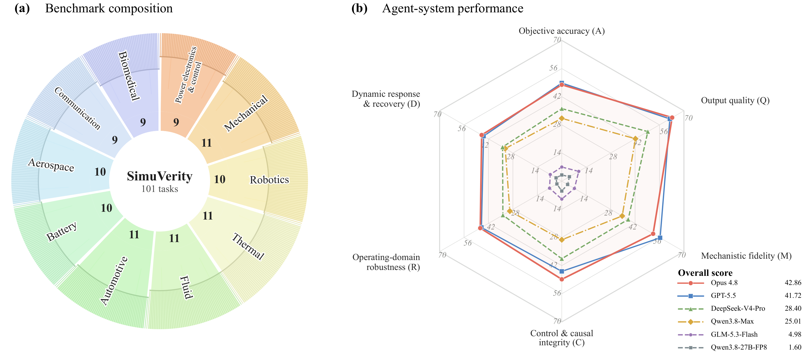

<div align="center">

# SimuVerity: Benchmarking Agents for Engineering-Grade Simulink Model Generation

**Ruiqi Zhang**<sup>\*</sup>, **Jiahao Wang**<sup>\*</sup>, Mingxuan Li, Haichen Luo, Chaoting Wang, Guoyu Mou, Keyu Lai, Hanchao Lv, Jiaxu Wang, Yibo Zheng, **Aijun Yang**<sup>†</sup>, **Xiaohua Wang**<sup>†</sup>

Xi'an Jiaotong University

<sup>\*</sup>Equal contribution &nbsp;&nbsp; <sup>†</sup>Corresponding authors

[Paper (arXiv)](https://arxiv.org/abs/2610.02304) &nbsp;|&nbsp; [Project Page](https://simuverity.github.io/SimuVerity/) &nbsp;|&nbsp; [Leaderboard](#leaderboard) &nbsp;|&nbsp; [Citation](#citation)

</div>

<p align="center">
  
</p>

## News

- **2026-10**: The paper is released on arXiv, together with the 101-task benchmark and experimental results.

## Overview

Existing Simulink benchmarks mainly evaluate whether generated models compile, execute, or resemble a reference model. These criteria do not establish whether a model satisfies its engineering requirements. We introduce SimuVerity, a benchmark of 101 text-to-executable Simulink model-generation tasks across ten engineering domains. For each task, executable-system profiles ground the engineering specification and four families of native simulation scenarios. A hierarchical evaluator first checks artifact delivery, native executability, and engineering qualification, then scores qualified models across six dimensions covering accuracy, output quality, mechanistic fidelity, control and causal integrity, operating-domain robustness, and dynamic response. We evaluate six agent systems with SimuVerity. The best system achieves an overall score of only 42.86. The results show that structural similarity is a poor proxy for engineering performance: capability bottlenecks arise both in producing qualified implementations and in satisfying multidimensional requirements after qualification. Meanwhile, some high-scoring models still exhibit severe visual-layout disorder. SimuVerity provides a systematic basis for assessing agents' engineering capabilities and diagnosing failures in executable Simulink model generation.

## Repository Contents

**`SimuVerity-benchmark/`: Benchmark Definition and Evaluation Execution**

This directory contains 101 tasks across ten engineering domains and their
evaluation specifications, including:

- public task prompts and delivery requirements;
- executable-system profiles;
- task-specific native simulation scenarios;
- reference system files or import recipes;
- evidence extractors and offline scorers;
- benchmark release and task-package validation tools.

**`SimuVerity-results/`: Experimental Results and Verification**

This directory contains experimental results and their
machine-readable metadata, including:

- three repeated runs of six agent systems on the complete 101-task set;
- the ten-task ablation under Full MCP, No-Simulation MCP, and Batch-only
  conditions;
- system-level and repeat-level overall scores and prerequisite-gate statistics;
- aggregate metadata and validation scripts.

The two directories are independently runnable. See
[`SimuVerity-benchmark/README.md`](SimuVerity-benchmark/README.md) for running
agents and scoring models, and
[`SimuVerity-results/README.md`](SimuVerity-results/README.md) for the result
format.

## Leaderboard

If you would like your agent system to be listed on the leaderboard, please
email us at ruiqizhang_swjtu@126.com or wjhwdscience@stu.xjtu.edu.cn, or
[open a GitHub issue](https://github.com/SimuVerity/SimuVerity/issues).

Overall scores and prerequisite pass rates. Agent results are three-run means;
Reference reports the mean score of 101 task-specific reference systems.

| Rank | Agent system | Overall | Delivered | Executable | G pass |
| :---: | --- | ---: | ---: | ---: | ---: |
| 1 | Opus 4.8 + Claude Code | 42.86 | 94.72% | 86.47% | 76.90% |
| 2 | GPT-5.5 + Codex | 41.72 | 98.68% | 94.72% | 75.58% |
| 3 | DeepSeek-V4-Pro + Claude Code | 28.40 | 97.03% | 88.12% | 61.39% |
| 4 | Qwen3.8-Max + Claude Code | 25.01 | 89.77% | 80.86% | 53.80% |
| 5 | GLM-5.3-Flash + Claude Code | 4.98 | 96.04% | 48.18% | 13.20% |
| 6 | Qwen3.8-27B-FP8 + Claude Code | 1.60 | 30.36% | 13.53% | 6.27% |
| - | **Reference** | 96.01 | 100.00% | 100.00% | 100.00% |

## Validation

Run the benchmark release checks:

```text
cd SimuVerity-benchmark
python -B tools/validate_system_profiles.py
python -B tools/validate_release.py
python -B -m pytest -q
```

Run the result checks:

```text
cd SimuVerity-results
python -B tools/validate_results.py
python -B -m unittest discover -s tests -v
```

The benchmark uses Python 3.11 or newer for its standard-library validation
commands. Reference workflows additionally require the MATLAB/Simulink
products specified by each task.

## License

First-party code and published result tables are available under the Apache
License, Version 2.0. Third-party reference assets retain the licenses and
notices identified in the relevant task directories and `licenses/third_party/`.

## Citation

If you find SimuVerity useful, please cite:

```bibtex
@article{zhang2026simuverity,
  title   = {SimuVerity: Benchmarking Agents for Engineering-Grade Simulink Model Generation},
  author  = {Zhang, Ruiqi and Wang, Jiahao and Li, Mingxuan and Luo, Haichen and Wang, Chaoting and Mou, Guoyu and Lai, Keyu and Lv, Hanchao and Wang, Jiaxu and Zheng, Yibo and Yang, Aijun and Wang, Xiaohua},
  journal = {arXiv preprint arXiv:2610.02304},
  year    = {2026}
}
```
